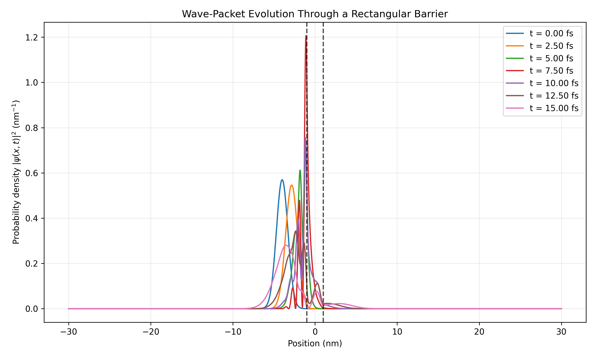
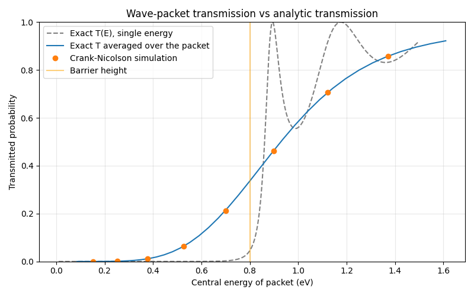

# Quantum Tunnelling Through a Double Barrier

A computational physics project investigating one-dimensional quantum tunnelling through a double-barrier potential using time-dependent wave-packet evolution and stationary-state transmission calculations.

## Overview

Quantum tunnelling allows a quantum particle to pass through a classically forbidden potential barrier. In a double-barrier system, partial reflections between the barriers can produce resonant transmission at particular energies.

This project numerically investigates wave-packet evolution in a double-barrier potential and calculates the energy-dependent transmission and reflection probabilities using a transfer-matrix method.

## Physical Model

The system consists of two rectangular potential barriers separated by a central potential well.

Parameters used in the main simulation:

| Parameter | Value |
|---|---:|
| Particle | Electron |
| Barrier height | 0.8 eV |
| Barrier width | 0.5 nm |
| Central well width | 2.0 nm |
| Spatial domain | −30 nm to +30 nm |
| Spatial grid points | 5001 |
| Initial wave-packet centre | −4 nm |
| Initial wave-packet width parameter | 0.7 nm |
| Central wave number | \(4 \times 10^9\ \mathrm{m}^{-1}\) |
| Time step | \(5 \times 10^{-19}\ \mathrm{s}\) |
| Total simulated time | 30 fs |

The initial state is a normalized Gaussian wave packet with a spatially varying complex phase, giving it a positive average momentum.

## Numerical Methods

### 1. Time-dependent Schrödinger equation

The wave packet is evolved using the Crank–Nicolson finite-difference method. The spatial second derivative is approximated on a uniform grid, producing a tridiagonal discrete Hamiltonian.

The resulting tridiagonal system is solved using the Thomas algorithm.

The simulation records probability-density snapshots and calculates probability in the left region, the barrier regions, the central well, and the right region.

### 2. Transfer-matrix method

A separate stationary-state calculation evaluates transmission and reflection across the four interfaces of the double-barrier structure.

The energy scan covers 0.05–0.95 eV. Wavefunction and derivative continuity are imposed at each interface to calculate the transmission and reflection amplitudes.

For identical free-particle regions on both sides, the transmission and reflection probabilities satisfy

\[
T + R \approx 1.
\]

### 3. Numerical validation

The project includes checks of:

- Initial wavefunction normalization.
- Total probability during time evolution.
- Finite numerical values in the transmission scan.
- Transmission-plus-reflection conservation at selected incident energies.
- Sensitivity to spatial-grid resolution and time-step size.

Convergence tests were performed by varying the numerical resolution and time step. The resulting observables changed only slightly over the tested settings. These tests provide evidence of numerical stability for the quantities examined, rather than proof that all numerical errors are absent.

## Results

### Double-barrier potential


### Wave-packet evolution

The time-dependent simulation shows the incident wave packet interacting with the double-barrier structure. Probability density appears in the central well and to the right of the barriers as the evolution proceeds.



### Transmission through a double barrier

The stationary transfer-matrix calculation produces an energy-dependent transmission spectrum with pronounced peaks associated with resonant transmission.


### Comparison of transmission calculations

The comparison figure displays the stationary transfer-matrix result alongside the numerical transmission result obtained from the Crank–Nicolson calculation.



The interpretation of this comparison depends on how the time-dependent transmission was extracted and whether the wave packet had sufficiently separated into incident, reflected, and transmitted components.

### Boundary-reflection investigation

The following figures compare simulations with and without reflections from the finite-domain boundaries.


Finite computational domains can introduce artificial reflections unless boundary treatment or simulation timing prevents reflected waves from affecting the region of interest.

## Reproducibility

The main simulation is provided in `Double_barrier.py`.

Required Python packages:

- NumPy
- Matplotlib

Install them with:

```bash
python -m pip install numpy matplotlib
```

Run the simulation with:

```bash
python Double_barrier.py
```

The script generates diagnostic output and plots for the potential, wave-packet evolution, and transmission spectrum.

## Limitations and Future Work

- The time-dependent wave-packet simulation and stationary transfer-matrix calculation are separate approaches; their agreement should be assessed quantitatively using a clearly defined transmission-extraction procedure.
- The finite spatial domain and boundary treatment can influence long-time wave-packet evolution.
- The reported resonance locations depend on the energy-grid resolution and should be refined when precise resonance energies are required.
- Further work could systematically quantify convergence errors and compare time-dependent and stationary transmission under matched physical and numerical conditions.

## Technologies

- Python
- NumPy
- Matplotlib
- Finite-difference methods
- Crank–Nicolson time evolution
- Thomas algorithm
- Transfer-matrix method

## Project Status

The core numerical implementation and initial validation checks are complete. The project is being documented and prepared for further reproducibility and quantitative comparison.
